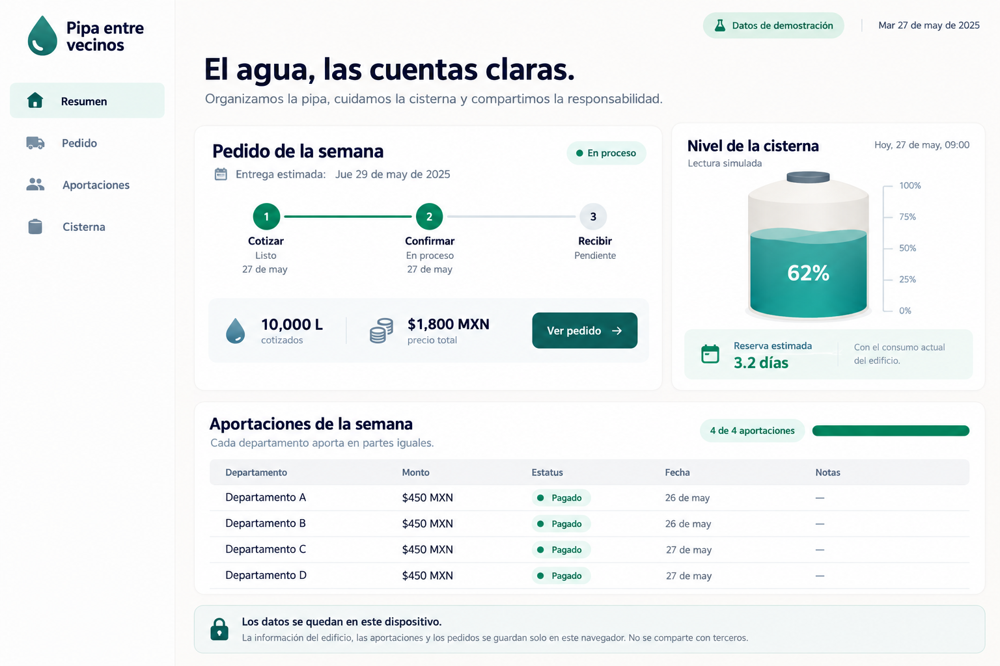
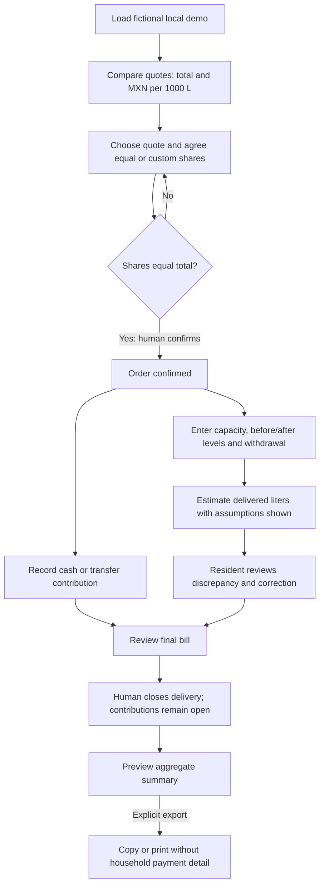
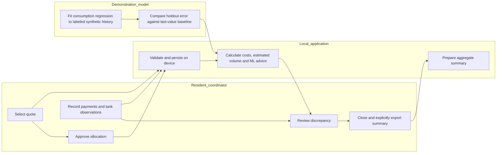

# PACKET - Pipa entre vecinos / Week 11

Author: Rodrigo Peña de León Pérez / USER. Created before application code on 21 October 2026 (Mexico City). Source constraint: `../../02_team_bending/BLUEPRINT_TEAM_WEEK11.md`, a synthesis proposed from five submitted briefs; not a transcript of a team vote.

## Problem and exact user

The resident coordinating one shared pipa delivery into a building's communal cistern needs to compare total quotes, agree shares, record contributions and reconcile the delivered water and final bill. Fragmented messages make the coordination work difficult to reconstruct. Initial prototype: a single operator on one device, with fictional apartments A-D and invented provider labels. No real resident data or water services are onboarded.

## Success before module closes

At a live URL, a reviewer can choose a fictional quote, review four apartment shares, confirm an order, log cash/transfer contributions, enter calibrated tank observations with concurrent withdrawal, review a volume discrepancy and close the delivery with a correction history. The shareable/printable summary excludes individual contribution histories and raw readings. All money calculations reconcile to the cent; no real payments occur. Data persists locally between reloads. No order, charge or access restriction is automatic.

## Image-generated mockup

The image is generated before implementation and retained as a design reference. Exact implementation can differ where validation and accessibility require it. Visual direction: civic, calm, off-white, ink navy, teal; accessible Spanish, clear next action, little decoration. Layout: narrow navigation; active order; storage gauge; contribution register; visible simulation label.

## Feature flow

## Actor swimlane

## Benchmark line

The closest existing shared-expense benchmark is Splitwise; the relevant water visibility precedents are NextDrop (historical SMS arrival alerts) and CityTaps (meter-linked service accounting). This slice localizes the combination to Spanish/MXN and a communal Mexican cistern, separating quoted from estimated liters and limiting group exports to approved aggregates.

- Splitwise official workflow: https://kb.splitwise.com/getting-started/how-do-i-use-splitwise
- NextDrop research, NSDR 2012: https://www.usenix.org/system/files/conference/nsdr12/nsdr12-final13.pdf
- GSMA CityTaps study, 2020: https://www.gsma.com/solutions-and-impact/connectivity-for-good/mobile-for-development/wp-content/uploads/2020/12/Scaling-Digital-Solutions-in-the-Water-Sector-Lessons-from-CityTaps-and-Wonderkid.pdf
- Published human anchor: https://water.org/our-impact/all-stories/time-is-money/

These sources were checked during the individual brief; this build does not claim current product trials or measured local savings.

## Long view / three years

If this slice proves useful, the product becomes a resident-controlled coordination and delivery record for shared water storage. It can later connect calibrated sensing and a verified delivery partner while preserving offline participation and explicit sharing. Growth depends on measured coordinator effort, viable support costs and residents retaining the power to correct the record.

## Scope cut

No supplier directory, real supplier onboarding, public-contract audit, fund custody, auto-buying, debt scores, water shutoff, public debtor lists, real personal information, remote database, commercial forecasting promises or certified measurement. No claims that this prototype repairs pipes, creates water, detects fraud or certifies water quality. An actual multi-user deployment with personal data needs authentication and access controls; the current app accepts only fictional fixed unit/provider identifiers.

## Architecture and Dragon Stack

| Layer | Implementation | Honest boundary |
|---|---|---|
| UI | Buildless HTML/CSS and ES modules, responsive Spanish app | One device, demonstration mode |
| IoT / sensing | Local simulated level history, manual before/after/calibration inputs | No physical sensor connected; on-screen label |
| ML | Ordinary least squares linear consumption forecast fitted in browser to synthetic days; temporal train/holdout split and MAE vs persistence | Demonstrates a trained algorithm, not household-validated prediction; never predicts public supply arrival |
| Third layer | Quote comparison by MXN/1000 L, shared-cost allocation and order state machine | Fictional quotes, no real market or payments |
| Storage | Versioned localStorage, schema validation, storage failure message; offline cache | Raw readings never leave browser through application APIs |
| Export | User-previewed aggregate copy/print | Excludes contribution history, identifiers and raw sensing history |
| Hosting | Static Sites, public demo authorized on 21 October 2026 | Public URL and public GitHub source checked separately; fictional data only |

Volume: `capacity * (afterPercent - beforePercent) / 100 + withdrawalsLiters`; withdrawals during delivery must be added to the net storage change. This estimate relies on calibrated percentage-to-volume mapping. Night drops alone do not prove a leak. Custom cost splits must sum exactly to quote total; round equal shares using integer cents and distribute the remainder deterministically.

## Conditions mapped to implementation

1. Raw data local; explicitly preview aggregate export; no background application data transmission.
2. No scoring or access denial; cash method; no resident account needed; printable summary.
3. Separate quote and estimate, calibration and withdrawals; record corrections; no accusation.
4. Fixed demonstration coordinator handles discrepancy; no custody or automated payment withholding.
5. Full-cost pilot worksheet in documentation; no claimed ROI or user-time savings.
6. Simulation labels; actual regression fit with reported holdout metrics and baseline; advice only.

## Test plan and acceptance

- Money: MXN 1,800/4 = 450 each; odd-cent totals still reconcile; negatives, NaN, oversized or mismatched custom shares rejected.
- Payments: cash/transfer only; overpayments rejected; fractional-cent input rejected; correction creates audit entry, never silently overwrites history.
- State: draft -> confirmed -> delivery review -> closed; cannot close without reviewed delivery; closing freezes delivery readings and allocation; contributions and audit-preserving payment corrections remain open.
- Sensing: 10,000 L capacity, 20% -> 65%, 500 L withdrawals = 5,000 L estimated; reject unknown calibration, negative withdrawals and invalid percentages.
- ML: deterministic synthetic data, temporal holdout, finite MAE and forecast; do not call a constant rule ML; screen says synthetic training.
- Persistence: validate saved state; handle malformed JSON, unknown version and quota denial; reload preserves valid demo state.
- Browser: desktop and narrow mobile; keyboard focus, error associations, no clipping; full order walkthrough; export omits per-apartment payment histories.
- Find and document at least one real bug, fix it, rerun relevant tests and redeploy. Do not manufacture a test result.
- Persona requirement: a separate fresh synthetic-persona walkthrough with screenshots remains distinct from mechanical QA; never represent real users as tested when they were not.

## Commit and deploy plan

1. Packet, mockup and implementation criteria before code.
2. Core calculation/state validation and meaningful tests.
3. Responsive functional UI and local persistence.
4. Sensing/ML module and integration, deployment 1.
5. Observed bug fix and usability refinement, retest and deployment 2.

Every session closes with DECISIONS.md, next step, commit and push where access is available. Preserve real history; do not backdate or create empty commits to meet counts.

## Addendum after synthetic persona review

A coordinator who does not know calibrated volume can register receipt without measurement. `liters: null` remains unknown, no numerical discrepancy is invented, and human review is still required. Replacing that receipt with a calibrated estimate clears review. This usability change follows the packet's calibration and inclusion constraints.

## Redesign and correctness addendum / 21 October 2026

Startup identity follows the user's visual references with original generated art, blue/yellow palette, top navigation and a responsive app. Full-cost categories and comparison formulas are now provided in `docs/PILOT_COST_WORKSHEET.md`; actual pilot costs remain to be collected. Corrected readings are retained in a local version history; closing a delivery freezes its readings but does not prevent later contributions or payment corrections. The full raw visible development exchange is exported separately from local chat records with hidden reasoning, instructions and credentials excluded, rather than reconstructed as a summary.
